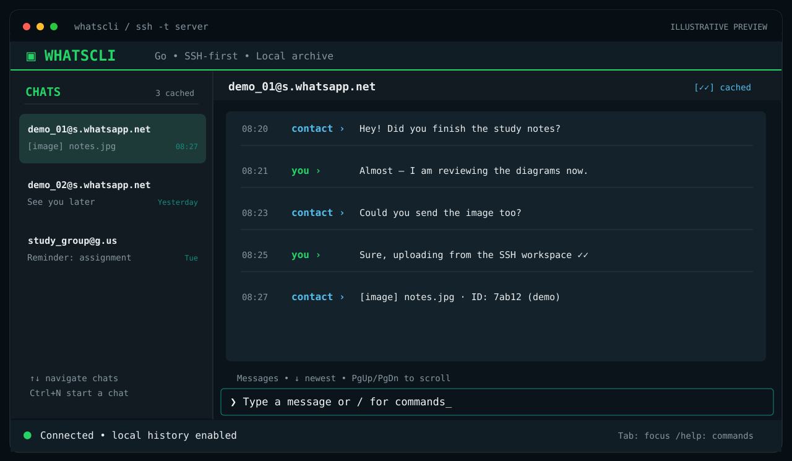
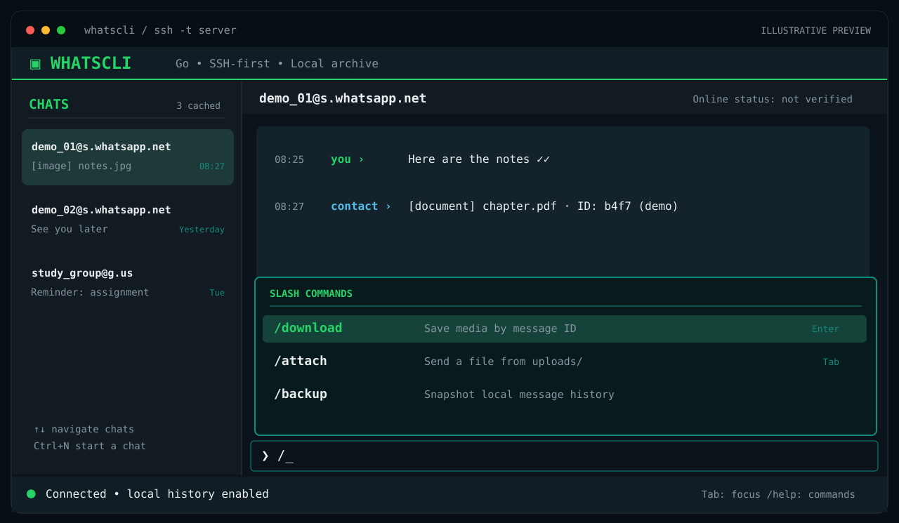
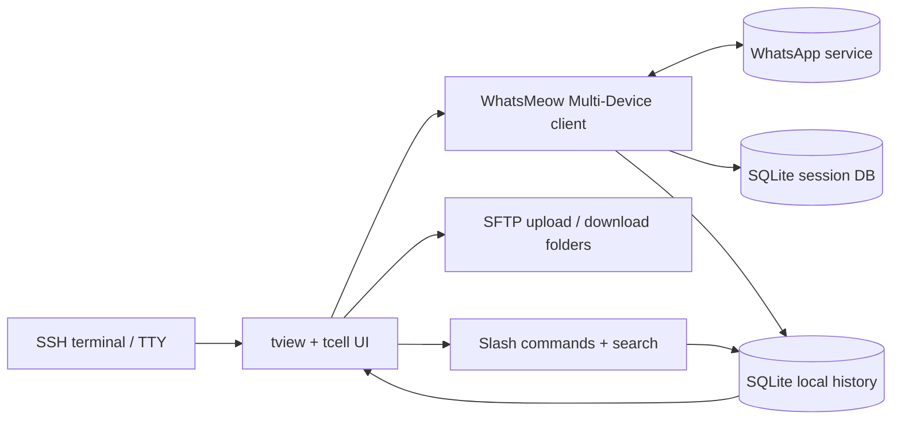

<div align="center">

# 💬 WhatsCLI

### WhatsApp in your terminal. Built for SSH. Written in Go.

**A fast, keyboard-first WhatsApp Multi-Device client with a local SQLite archive and a WhatsApp-inspired terminal interface.**

[](https://github.com/sepisotoni/WhatsCLI/actions/workflows/ci.yml)


[Quick start](#-quick-start) · [Preview](#-terminal-preview) · [Commands](#-keyboard--commands) · [Architecture](#-architecture) · [Roadmap](#-what-works-today)

</div>

> [!IMPORTANT]
> **v0.2 is a development release, not a finished WhatsApp Desktop replacement.** The Go project compiles and its automated CI checks pass. Pairing, messaging and media flows **still require a real-account / real-SSH acceptance test**. WhatsCLI is an **unofficial client**, not affiliated with or endorsed by WhatsApp or Meta. Use a test account first and follow the service's terms.

## ✨ Terminal preview



<details>
<summary><strong>View the slash-command palette</strong></summary>



</details>

**About these images:** These are *illustrative, code-based UI mockups* following the project's dark emerald/slate styling—not captured from a linked WhatsApp account. Actual rendering depends on your terminal, size and color support. The client currently displays raw chat JIDs; contact display names are on the roadmap. Screenshots from a real PTY session will replace these previews after interactive testing.

## ⚡ Why WhatsCLI?

| 🖥️ Terminal native | 🗃️ Own your local archive | 🔐 SSH-friendly |
|:--|:--|:--|
| Designed for a TTY, mouse and keyboard; no browser or desktop environment required | Chat messages live in your local SQLite database with edit versions and deletion flags | Works in ordinary terminal sessions; uses SFTP for attachments rather than pretending SSH has native drag-and-drop |

- **Keyboard-first:** Tab navigation, searchable slash palette, shortcuts for chats and search.
- **Go throughout:** `tview` / `tcell` interface, WhatsMeow protocol integration, and a CGO-free SQLite driver for normal builds.
- **Offline-friendly:** Read messages already cached locally even when WhatsApp is disconnected.
- **Transparent development:** Automated formatting, race tests, static analysis, vulnerability scanning and release builds.

## 🚀 Quick start

**Requirements:** Go **1.27.3** (as used in the workflow), an existing WhatsApp account, a UTF-8 terminal, and network access for first-time dependency download and pairing. Linux is the primary SSH target; macOS and Windows build targets are configured but not yet interactively verified.

```bash
git clone https://github.com/sepisotoni/WhatsCLI.git
cd WhatsCLI

go mod tidy                 # generate/refresh go.sum, currently not committed
go run ./cmd/whatshell
```

On your phone: **WhatsApp → Linked devices → Link a device**, then scan the QR displayed in the terminal. Reopening the client should reuse the persisted Multi-Device session while the link remains valid. A terminal of roughly **90 × 30** or larger is recommended for first-time QR pairing.

### Build a standalone binary

```bash
CGO_ENABLED=0 go build -trimpath -o bin/whatshell ./cmd/whatshell
./bin/whatshell
```

> **Go module note:** The source module currently retains the original identifier `github.com/sepisotoni/whatshell-go`; the GitHub repository is `sepisotoni/WhatsCLI`. Building from a clone works because internal imports use the existing module name. The naming will be standardized in a future cleanup.

### Run over SSH

Install/build on your server, then from your local computer:

```bash
ssh -tt user@your-server 'cd ~/WhatsCLI && ./bin/whatshell'
```

For reliable colors, use a UTF-8 terminal with a working `$TERM` entry (commonly `xterm-256color` or `screen-256color`). Mouse input and resizing work through `tcell`'s terminal handling, but vary by SSH client and terminal emulator. Prefer public-key SSH authentication and **do not run the client as root**.

## ⌨️ Keyboard & commands

| Control | Action |
|:--|:--|
| **Tab** | Cycle panes; autocomplete the first matching slash command |
| **Enter** | Send message / execute command |
| **Arrow keys / PgUp / PgDn** | Navigate the focused list or scroll message history |
| **Mouse** | Click chats, scroll history, select UI elements |
| **Ctrl + N** | Open a new chat by international phone number |
| **Ctrl + F** | Search the offline message archive |
| **Ctrl + L** | Toggle the sidebar on small terminal widths |
| **Ctrl + C** | Exit without unlinking |
| `/help` | Show built-in help |
| `/chat 27123456789` | Open a chat by country-code phone number |
| `/chats` | Choose a cached conversation |
| `/search text` | Search messages stored on this machine |
| `/versions MESSAGE_ID` | Read cached prior versions of an edited message |
| `/attach photo.jpg` | Send a file staged in `uploads/` (up to 16 MiB) |
| `/download MESSAGE_ID` | Save an incoming attachment to `downloads/` |
| `/poll Question \| Yes \| No` | Create a single-choice WhatsApp poll |
| `/backup` | Create a plaintext history snapshot (not the login keys) |
| `/logout` | Request remote unlink and remove local session files, **keeping chat history** |
| `/quit` | Exit the application |

Typing `/` in the message input opens a **live-filtered command palette**. Use Tab to complete a suggestion; commands appear as you type.

## 📂 Sending files through SSH

A conventional SSH terminal cannot accept operating-system drag-and-drop into a remote program. Upload attachments with SFTP first:

```bash
# From your own computer
sftp user@your-server
# In the SFTP prompt:
# put ./photo.jpg .local/share/whatshell-go/uploads/photo.jpg
```

Inside WhatsCLI, open a chat and enter `/attach photo.jpg`. The current transfer implementation accepts ordinary JPEG/PNG images and documents up to **16 MiB**, rejects upload paths outside its private root, and downloads incoming media on demand. No downloaded file is auto-executed or auto-opened. **Live media compatibility is still awaiting account-level testing.**

If `$WHATSHELL_HOME` is configured on the server, upload into `$WHATSHELL_HOME/uploads/` instead.

## 🗄️ Local data & privacy

Default storage: `~/.local/share/whatshell-go/` (also honors `$XDG_DATA_HOME` or `$WHATSHELL_HOME`).

```text
~/.local/share/whatshell-go/
├── session.sqlite3      # WhatsApp device + authentication secrets
├── history.sqlite3      # Chat messages + edit history + deletion flags
├── uploads/             # Files staged via SFTP
├── downloads/           # Explicitly saved received media
└── backups/             # History-only SQLite snapshots
```

The application attempts to restrict its data directories to `0700` and database files to `0600`. SQLite uses WAL and synchronous writes for the message archive. These controls reduce accidental exposure, **but the database is not encrypted at rest**. Protect your server and backups with disk encryption, and never upload session keys, chat databases, or screenshots with personal conversations to a public issue.

**Deleted and edited messages:** WhatsCLI retains *already observed* message bodies when a revocation event arrives, and stores previous bodies when it receives edit events. It cannot reconstruct messages it never received or bypass view-once/disappearing-message limitations. Backups can preserve plaintext conversation history; consider the privacy implications for everyone in those chats.

`/logout` removes local session data but keeps cached history. A remote unlink failure must be verified in WhatsApp's Linked devices screen. Local file deletion is **not** guaranteed forensic erasure on SSDs.

## 🧩 Architecture



| Area | Source |
|:--|:--|
| Entrypoint | [`cmd/whatshell`](cmd/whatshell) |
| Terminal interface & command palette | [`internal/ui`](internal/ui) |
| WhatsApp transport, media, polls | [`internal/wa`](internal/wa) |
| SQLite persistence, history & backups | [`internal/store`](internal/store) |
| Private paths & permissions | [`internal/config`](internal/config) |
| SFTP drop-off and download safety | [`internal/transfer`](internal/transfer) |
| CI and release automation | [`.github/workflows`](.github/workflows) |

## ✅ What works today?

| Feature | Development state |
|:--|:--|
| Go build, linting, tests, race detection, static checks | ✅ Passing in GitHub Actions |
| Local SQLite history, edit versions, deletion tombstones, search | ✅ Source implemented & unit-tested |
| Backup snapshots and private-directory guards | ✅ Source implemented & unit-tested |
| TUI layout, resize handling, keyboard/mouse, slash autocomplete | ✅ Source implemented; additional UI tests added |
| WhatsApp QR pairing & persisted sessions | 🟡 Integrated; live-account test pending |
| Send/receive messages & read receipts | 🟡 Integrated; live-account test pending |
| Initial history sync, image/document upload & media download | 🟡 Integrated; live-account test pending |
| Create single-choice polls | 🟡 Integrated; live-account test pending |
| Poll voting/results, voice-note sending, contact names | ⚪ Planned |
| Status viewing/posting, video-in-terminal, media previews | ⚪ Planned |
| Full desktop feature parity & guaranteed zero data loss | ❌ Not claimed |

Automated tests **do not prove** live WhatsApp interoperability, SSH terminal compatibility across every emulator, or perfect data retention. An authorized account + PTY acceptance pass is required before a stable release.

## 🧪 Development & CI

```bash
go mod tidy
go test -race -count=1 ./...
go vet ./...
bash scripts/check.sh
CGO_ENABLED=0 go build ./cmd/whatshell
```

[GitHub Actions](https://github.com/sepisotoni/WhatsCLI/actions) runs `gofmt`, `go vet`, custom checks, race-enabled tests, coverage, `golangci-lint`, Staticcheck, gosec, govulncheck, and a CGO-free build on pushes/PRs. Dependabot monitors dependencies. Tagged `v*` builds are configured for multiple operating systems, with SHA-256 checksums.

Race-enabled **testing** needs a working compiler/CGO on supported platforms; the normal **release binary** can still be built without CGO. Static analysis catches many errors, but not every performance issue or vulnerability.

## 🛣️ Roadmap

- **v0.3:** complete live login/messaging acceptance tests; polish message UX, group display, reconnect behavior, queued sends, poll voting, voice notes.
- **v0.4:** WhatsApp statuses where available, terminal media adapters, tmux notifications, terminal-resize screenshot/fuzz tests.
- **v1.0:** portable releases, encrypted backup options, exhaustive protocol testing, performance profiling and long-running SSH soak tests.

See the [real-device acceptance checklist](docs/ACCEPTANCE.md), [architecture](docs/ARCHITECTURE.md), [detailed roadmap](docs/ROADMAP.md), [changelog](docs/CHANGELOG.md), and [security guidance](SECURITY.md).

---

<div align="center">

**Made for people who live in the terminal.**

*WhatsCLI is an independent, experimental project and is not an official WhatsApp product.*

</div>